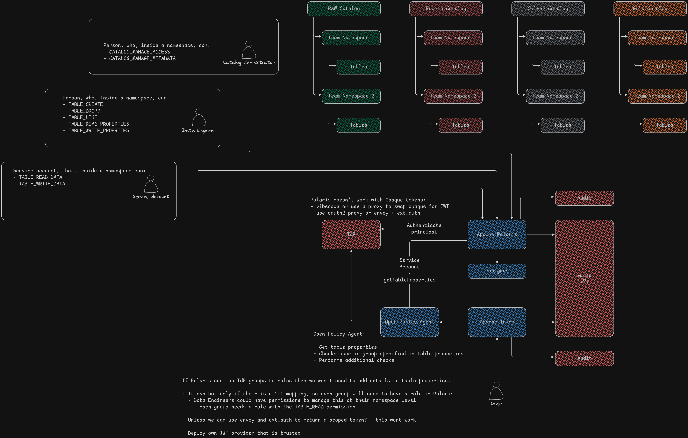
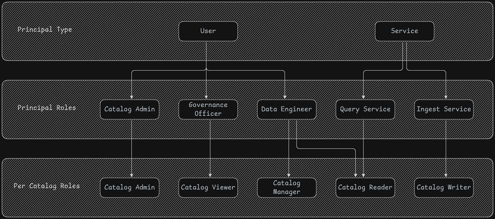

# Polaris entities:

- **Catalog:** logical grouping of namespaces, tables, views and access policies. Each catalog is independent from each other.
- **Principals:** represents users or services interacting with the system. They are assigned principal roles.


# Polaris RBAC 



## Principal Roles:

Principal roles aggregate catalog roles and assign them to principals.

### Global Privileges:

1. Service Admin      - user - manages the polaris instance (provisions catalogs).
2. Governance Officer - user - performs governance checks.

### Per Catalog Privileges:

1. Catalog Admin  <Catalog>  - user            - manages a catalog (creates namespaces and tables).
2. Query Service  <Catalog>  - service account - reads data for user querying.
3. Ingest Service <Catalog>  - service account - writes data to tables in catalog.namespace.


## Catalog Roles:

Catalog roles define a set of permissions to determine what actions a principal role assigned to the catalog can perform or resources (catalog, namespaces, tables & views). Catalogs roles are assigned to principal roles.


These roles exist in each catalog:

1. Catalog Admin      - create and delete namespaces, manages permissions
2. Catalog Viewer     - view tables and metadata for governance purposes
3. Catalog Manager    - create and delete tables and views
4. Catalog Reader     - read data and metadata from table
5. Catalog Writer     - write data to table


# Polaris deployment

## POLARIS_BOOTSTRAP_CREDENTIALS

`POLARIS_BOOTSTRAP_CREDENTIALS` is an environment variable in Apache Polaris (an open-source Iceberg REST catalog) used to initialize and set up the root principal and credentials on first boot.

• Syntax: REALM,CLIENT_ID,CLIENT_SECRET
• Example: POLARIS,root,s3cr3t

**The polaris instance needs to be boot straped before configuring an external IdP**

## Boostrap

```bash
polaris \
    --base-url=http://localhost:8181 \
    --client-id=root \
    --client-secret=s3cr3t \
    setup apply quick-start.yaml
```


## DEX

Dex is an identity service that can defer authentication to other identity services such as LDAP or OIDC. It provides OIDC for integration into your apps.

### Get a token from DEX:

```bash
echo -n $(curl -L -X POST 'http://localhost:5556/dex/token' \
    -H 'Content-Type: application/x-www-form-urlencoded' \
    --data-urlencode 'grant_type=password' \
    --data-urlencode 'client_id=polaris' \
    --data-urlencode 'scope=openid profile groups' \
    --data-urlencode 'username=judas@example.com' \
    --data-urlencode 'password=password') | python3 scripts/parse_token.py
```
- ID Token (id_token): A signed JWT containing user claims (such as sub, email, name, and groups).
- Access Token (access_token): Often an opaque string or a reference token used by Dex internals, though ID tokens carry the inspectable claims.


## S3 (rustfs)

### Create bucket

```
AWS_ACCESS_KEY_ID=admin \
AWS_SECRET_ACCESS_KEY=password123 \
AWS_ENDPOINT_URL=http://localhost:9000 \
aws s3 mb s3://shadow-catalog

AWS_ACCESS_KEY_ID=admin \
AWS_SECRET_ACCESS_KEY=password123 \
AWS_ENDPOINT_URL=http://localhost:9000 \
aws s3 mb s3://light-catalog
```
