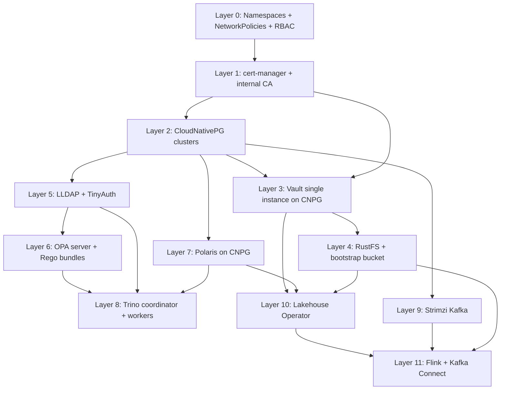

# Implementation Plan: Zero-Trust Iceberg Data Platform

> **Constraint:** No Helm charts authored by us. Upstream open-source operators (cert-manager, CloudNativePG, Strimzi, Vault, TinyAuth, LLDAP) are installed from their official Helm charts because the user explicitly asked for "open source helm charts and operators where possible." Our own workloads ship as raw Kubernetes manifests.

---

## 1. Confirmed Decisions

| Area | Decision |
|------|----------|
| S3 backend | RustFS (StatefulSet, Admin API) |
| Identity provider | TinyAuth + LLDAP deployed in-cluster (OIDC) |
| Operator language | Go + Kubebuilder / controller-runtime |
| Vault | Single instance, storage backend = CloudNativePG cluster |
| Ingestion runtimes | Flink + Kafka Connect both wired end-to-end |

---

## 2. Repository Layout

```
ice/
├── DESIGN.md
├── README.md                                 # bootstrap order + ops runbook
├── IMPLEMENTATION_PLAN.md                    # this file
├── Makefile                                  # kustomize build targets, apply, port-forward helpers
├── bootstrap/
│   ├── 00-namespaces.yaml                    # platform, cert-manager, vault, storage, polaris, trino, ingestion, ops
│   ├── 01-network-policies.yaml              # default-deny + explicit allow matrix
│   └── 02-rbac-bootstrap.yaml                # admin SA + cluster roles for bootstrap
├── platform/
│   ├── cert-manager/                         # Issuer, ClusterIssuer, CA cert Secret
│   ├── cloudnative-pg/                       # Cluster CRs: vault-db, polaris-db, lldap-db
│   ├── rustfs/                               # StatefulSet, Service, PVCs, bucket-init Job, root creds Secret
│   ├── vault/                                # Deployment, Service, ServiceAccount, cert-auth ConfigMap, init-job
│   ├── tinyauth/                             # Deployment, OIDC config, Service
│   ├── lldap/                                # StatefulSet, Service, ingress
│   ├── opa/                                  # Deployment, Service, ConfigMap with .rego bundles
│   ├── polaris/                              # Deployment, Service, ConfigMap, Ingress
│   ├── trino/                                # Coordinator + Worker Deployments, ConfigMaps, Ingress
│   └── strimzi/                              # KafkaNodePool + Kafka CR, topics
├── operator/
│   ├── lakhouse-operator/                    # Go module, Kubebuilder project
│   │   ├── api/v1alpha1/                     # LakehouseTable, LakehouseBucketPolicy CRDs
│   │   ├── controllers/                      # tablereconciler, bucketpolicy_controller
│   │   ├── pkg/rustfs/                       # admin client (IAM policy PUT)
│   │   ├── pkg/vault/                        # cert-auth role PUT
│   │   ├── pkg/polaris/                      # table-event listener (webhook receiver)
│   │   ├── config/                           # manager.yaml, webhook.yaml
│   │   └── Dockerfile
│   └── deploy/                               # raw k8s manifests for the operator
├── workloads/
│   ├── flink/                                # JobManager + TaskManager, ConfigMap, Vault Agent sidecar
│   └── kafka-connect/                        # Deployment, Connector CRs, Vault Agent sidecar
├── policies/
│   └── rego/                                 # trino_authorization.rego + bundles
├── plugins/
│   └── trino-opa-authorizer/                 # upstream plugin reference (trinodb/trino-plugin-opa-authorizer)
└── scripts/
    ├── install-operators.sh                  # helm installs for upstream operators
    ├── bootstrap-vault.sh                    # vault init, enable cert auth, register CAs
    ├── register-rustfs-policies.sh           # one-shot helper called by operator on first run
    └── verify.sh                             # end-to-end smoke test
```

---

## 3. Open-Source Projects Consumed

| Component | Source | Installation |
|-----------|--------|--------------|
| cert-manager | `jetstack/cert-manager` Helm chart | Helm (operator only) |
| CloudNativePG | `cloudnative-pg/cloudnative-pg` Helm chart | Helm (operator only) |
| Vault | `hashicorp/vault` Helm chart | Helm (operator only) |
| Strimzi | `strimzi/strimzi-kafka-operator` Helm chart | Helm (operator only) |
| TinyAuth | `steveiliop56/tinyauth` Helm chart | Helm |
| LLDAP | `lldap/lldap` Helm chart | Helm |
| Apache Polaris | `apache/polaris` image | Raw manifests |
| Apache Trino | `trinodb/trino` image | Raw manifests |
| Trino OPA Authorizer | `trinodb/trino-plugin-opa-authorizer` | Init-container into plugin dir |
| OPA | `openpolicyagent/opa` image (run as server) | Raw manifests |
| RustFS | `rustfs/rustfs` image | Raw manifests |
| Flink | `apache/flink` image | Raw manifests |
| Kafka Connect | `apache/kafka` + `apache/iceberg-kafka-connect` jar | Raw manifests + init container |
| Vault Agent | `hashicorp/vault` image | Sidecar (via Vault Agent Injector webhook) |
| Lakehouse Operator | Built by us (Go/Kubebuilder) | Raw manifests via `make install` |

---

## 4. Layered Implementation Plan (apply order)



### Layer 0 — Namespaces, RBAC, NetworkPolicies
- Namespaces: `platform-system`, `cert-manager`, `vault`, `storage`, `postgres`, `idp`, `polaris`, `trino`, `ingestion`, `ops`.
- Default-deny `NetworkPolicy` per namespace; explicit allow lists between known callers.
- Bootstrap `ServiceAccount` with `cluster-admin` for install scripts only.

### Layer 1 — cert-manager + Internal CA
- Install `cert-manager` via Helm.
- Self-signed **internal CA** `ClusterIssuer` (`selfsign-issuer`).
- **Pod-Client-Cert Issuer**: a `Issuer` per workload namespace signed by the internal CA.
- Root CA Secret consumed by Vault as `auth/cert/certs/*` certificate bundle.

### Layer 2 — CloudNativePG
- Install `cloudnative-pg` via Helm.
- Cluster CRs:
  - `vault-db` (1 instance, 10Gi) — Vault storage backend.
  - `polaris-db` (1 instance, 20Gi) — Polaris metadata.
  - `lldap-db` (1 instance, 5Gi) — LLDAP users/groups.

### Layer 3 — Vault
- Install `hashicorp/vault` Helm chart with `server.dev.enabled=false`, HA `replicas: 1`, `database` storage backend pointing at `vault-db` via CNPG user.
- Bootstrap `Job`:
  1. `vault auth enable cert`
  2. Write each namespace's root CA bundle to `auth/cert/certs/<sa-name>` with policy binding.
  3. Enable `kv-v2` at `secret/`.
  4. Write base policies: `s3-write`, `s3-read`, `polaris-admin`, `trino-coordinator`.
- Service: `vault.vault.svc:8200`, Ingress with TLS 1.3 only.

### Layer 4 — RustFS
- `StatefulSet` (3 replicas), PVC per replica, headless Service.
- `rustfs-config` ConfigMap: `RUSTFS_ACCESS_KEY`, `RUSTFS_SECRET_KEY` from Vault KV via init container.
- `bucket-init` `Job` creates `enterprise-lakehouse` bucket.
- Admin API endpoint (`http://rustfs.storage.svc:9001`) consumed by the Lakehouse Operator.

### Layer 5 — Identity (LLDAP + TinyAuth)
- Install LLDAP chart, configure admin password from Vault, default group `lakehouse-users`.
- Install TinyAuth chart, configure OIDC issuer URL `https://idp.platform.local/oidc`, redirect URIs for Trino and Polaris.

### Layer 6 — OPA
- `Deployment` of `openpolicyagent/opa` running `run --server`.
- ConfigMap-mounted `/policies/trino_authorization.rego` with `allow`, `rowFilters`, `columnMasks`.

### Layer 7 — Apache Polaris
- `Deployment` running `apache/polaris:latest`, env:
  - `QUARKUS_DATASOURCE_URL=jdbc:postgresql://polaris-db-rw.postgres:5432/polaris`
  - `QUARKUS_OIDC_AUTH_SERVER_URL=https://idp.platform.local/oidc`
  - `POLARIS_BOOTSTRAP_PRINCIPAL=...` (root credential in Vault KV)
- `Service` exposes REST endpoint `:8181`.
- `Ingress` with mTLS termination.
- Bootstrap `Job` creates the root catalog `enterprise-catalog` and registers S3 storage config pointing at RustFS with `s3://enterprise-lakehouse/`.

### Layer 8 — Trino Coordinator + Workers
- **Coordinator**:
  - Image: `trinodb/trino:435`
  - `config.properties`: `http-server.authentication.type=OIDCAuthentication`, `oidc.issuer-url`, `oidc.client-id`, `oidc.principal-claim=email`, `oidc.audience=trino`.
  - `access-control.properties`: `access-control.name=opa-authorizer`, `opa.policy.uri=http://opa.platform.svc:8181/v1/data/trino/authz`.
  - Init container copies `trino-opa-authorizer` JAR into `/usr/lib/trino/plugin/`.
  - Env: `AWS_ACCESS_KEY_ID`, `AWS_SECRET_ACCESS_KEY`, `AWS_REGION` injected by **Vault Agent sidecar**.
  - Vault Agent sidecar uses **client cert mTLS** to authenticate to Vault.
- **Workers**: identical minus OIDC + coordinator roles.
- `Ingress` with mTLS optional.

### Layer 9 — Strimzi Kafka
- Install Strimzi operator via Helm.
- `Kafka` CR (KRaft, 1-node dev / 3-node prod) and `KafkaNodePool`s.
- Topics: `audit.iceberg.completed` (placeholder for future replay — not wired to a sink in this iteration).

### Layer 10 — Lakehouse Operator (Go/Kubebuilder)
- CRDs:
  - `LakehouseTable` (spec: `catalog`, `namespace`, `name`, `bucket`, `prefix`, `serviceAccount`, `namespaceRef`).
  - `LakehouseBucketPolicy` (status of the RustFS IAM policy).
- Controllers:
  - `LakehouseTableReconciler` — reconciles on Polaris webhook events (POST `/v1/polaris-events`), creates child `LakehouseBucketPolicy`, updates Vault cert role.
  - `LakehouseBucketPolicyReconciler` — calls RustFS Admin API to PUT the policy JSON.
- Polaris integration: `notifications` config sends events to operator webhook.
- Build/deploy: `make docker-build`, push to local registry, raw `Deployment` + RBAC + `Certificate` for webhook TLS.

### Layer 11 — Flink + Kafka Connect
- Both workloads include **Vault Agent Injector annotations**:
  ```yaml
  annotations:
    vault.hashicorp.com/agent-inject: "true"
    vault.hashicorp.com/agent-inject-template-aws: |
      {{- with secret "aws-creds/orders-ingestion" -}}
      ...
      {{- end }}
    vault.hashicorp.com/role: orders-ingestion
    vault.hashicorp.com/auth-method: cert
    vault.hashicorp.com/client-cert-mount-path: /etc/certs
  ```
- **Flink**: `JobManager` + `TaskManager` Deployments, `flink-conf.yaml` mounts `iceberg-flink-runtime` JAR, points to Polaris REST catalog.
- **Kafka Connect**: single-node Deployment, plugin path includes `iceberg-kafka-connect` jar, `IcebergSinkConnector` writes to `s3://enterprise-lakehouse/sales.db/orders/` with catalog `enterprise-catalog`.

---

## 5. Cross-Cutting Concerns

### 5.1 Zero-Trust Networking
Every Service has a matching `NetworkPolicy`:
- Trino coordinator → RustFS (9000/9001)
- Trino coordinator → OPA (8181)
- Trino coordinator → Polaris (8181)
- Flink/Connect → RustFS, Polaris, Kafka, Vault
- Operator → RustFS admin, Vault, Polaris webhook

### 5.2 mTLS Identity Flow
```
[cert-manager] ──► Pod /etc/certs/tls.{crt,key}
                          │
                          ▼
                  Vault Agent sidecar
                          │  POST /v1/auth/cert/login
                          ▼
                  Vault issues short-lived token
                          │
                          ▼
                  Reads KV: secret/aws-creds/<sa>
                          │
                          ▼
                  Renders /vault/secrets/aws-credentials
                          │
                          ▼
                  Main container reads via
                  com.amazonaws.auth.PropertiesFileCredentialsProvider
```

### 5.3 Trino OPA Plugin Specifics
- Use upstream `opa-authorizer` (Trino plugin repo).
- Rego contract returns:
  ```rego
  decision := {
    "allow": true,
    "rowFilters": {"sales.orders": "department = 'US_FINANCE'"},
    "columnMasks": {"sales.orders.ssn": "regexp_replace(ssn, '.', '*', 'g')"}
  }
  ```
- Same OPA instance also serves Polaris admin decisions.

### 5.4 Vault Cert Auth Roles
Bootstrap `Job` writes one role per (namespace, serviceaccount) pair referenced by Polaris at table-creation time. Roles are created dynamically by the Lakehouse Operator; the bootstrap only registers the trusted CA.

---

## 6. Bootstrap Order

```bash
make apply-bootstrap       # L0
make install-cert-manager  # L1 (Helm)
make apply-cnpg            # L2 manifests → wait for clusters ready
make install-vault         # L3 Helm + bootstrap-job
make apply-rustfs          # L4
make install-lldap         # L5
make install-tinyauth      # L5
make apply-opa             # L6
make apply-polaris         # L7
make apply-trino           # L8
make install-strimzi       # L9
make apply-operator        # L10
make apply-flink           # L11
make apply-kafka-connect   # L11
make verify                # end-to-end: cert → vault → rustfs write → trino query
```

---

## 7. Risks, Deviations & Open Items

| # | Risk / Deviation | Mitigation / Decision Needed |
|---|------------------|------------------------------|
| 1 | **Audit/logging removed**: Trino EventListener SPI and Vector → Postgres audit pipeline removed per user request. No structured query audit trail in this iteration. | Future iteration can reintroduce via Kafka Connect + OpenSearch, or a custom Trino EventListener writing to Postgres directly. |
| 2 | **RustFS Admin API maturity**: IAM-style per-prefix policies may not be supported the way MinIO supports them. | Verify before implementing operator's `s3_admin_client`. Fallback: enforce path isolation at the bucket layout level (one prefix per table with separate access keys per role). |
| 3 | **Polaris notification surface**: Polaris must be wired to the operator's webhook. | Confirm Polaris version supports `notifications` config. Otherwise poll the REST catalog periodically. |
| 4 | **Trino OPA authorizer version**: must match Trino server version (435). | Pin versions in `platform/trino/configmap.yaml`. |
| 5 | **Vault single instance** = availability bottleneck for cert refresh. | Acceptable for first iteration; add Raft HA later. |
| 6 | **TinyAuth OIDC scope**: ensure it issues `groups` claim from LLDAP. | Configure LLDAP group sync into TinyAuth claims; test with `oidc-tester`. |
| 7 | **CNPG + Vault storage**: officially supported but slower than Raft. | Acceptable per user decision; document disaster recovery (DB snapshot). |

---

## 8. Testing Strategy

1. **Layer tests**:
   - Vault cert auth: test pod with cert-manager-issued cert logs into Vault and reads a secret.
   - RustFS: write+read against a path-scoped IAM policy.
   - Trino OPA: `opa test policies/rego`.
2. **Integration** (`scripts/verify.sh`):
   - Issue cert to `orders-ingestion-sa`.
   - Vault Agent renders AWS creds; Flink/Kafka Connect writes to `s3://enterprise-lakehouse/sales.db/orders/`.
   - Polaris notification fires; operator creates bucket policy and Vault role.
   - Trino query against `sales.orders` returns row-filtered results via OPA.
3. **Negative tests**:
   - Read outside the table prefix → denied (RustFS 403).
   - Row-filtering SQL bypass attempt → denied (Rego rule).
   - Expired client cert → Vault Agent refresh failure → workload pod stuck on init.

---

## 9. Effort Buckets

| Bucket | Scope | % |
|--------|-------|---|
| A. Cert-manager + Vault cert auth + Vault Agent sidecars | ~25% |
| B. CNPG + RustFS + bootstrap scripts | ~12% |
| C. TinyAuth + LLDAP + OIDC wiring into Trino/Polaris | ~12% |
| D. Polaris deployment + S3 storage config | ~8% |
| E. Trino coordinator/worker + OPA plugin | ~18% |
| F. Lakehouse Operator (Go/Kubebuilder) | ~18% |
| G. Flink + Kafka Connect with Vault Agent + Iceberg sink | ~7% |

F and E are the heaviest items.
